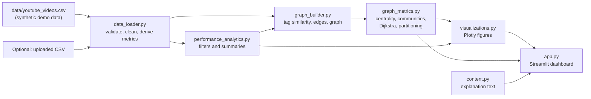

# YouTube Video Topic Network and Performance Analytics Using Graph Analytics

An interactive Streamlit dashboard that models YouTube-style videos as a **graph**. Videos become nodes and are
connected when they share tags/topics, so you can explore topic clusters, bridge videos, importance rankings
(centrality and PageRank), communities, shortest paths (Dijkstra) and performance analytics.

> **Important - synthetic data.** The included dataset (`data/youtube_videos.csv`) is **synthetic demo data** created by
> `scripts/generate_sample_data.py`. Channel names, titles, view counts and traffic-source percentages are invented.
> It is **not** live or official YouTube data, and the dashboard is **not** connected to YouTube.
> No API key, account, database or paid service is needed.

---

## Contents
1. [Overview and objectives](#1-overview-and-objectives)
2. [Problem statement and motivation](#2-problem-statement-and-motivation)
3. [Features](#3-features)
4. [Technology stack](#4-technology-stack)
5. [Architecture and data flow](#5-architecture-and-data-flow)
6. [Dataset schema](#6-dataset-schema-and-synthetic-data-disclaimer)
7. [How the graph is built](#7-how-the-graph-is-built)
8. [Algorithms and metrics explained](#8-algorithms-and-metrics-explained)
9. [Syllabus mapping](#9-syllabus-mapping)
10. [Setup on Windows with VS Code](#10-setup-on-windows-with-vs-code)
11. [Running the tests](#11-running-the-tests)
12. [Troubleshooting](#12-troubleshooting)
13. [Using your own CSV](#13-replacing-the-sample-csv-with-your-own-data)
14. [Optional live YouTube data](#14-optional-live-youtube-data-not-included)
15. [Limitations, privacy and ethics, future work](#15-limitations-privacy-and-ethics-future-enhancements)
16. [Demo script for your lecturer](#16-short-demo-script)
17. [Publishing to GitHub](#17-publishing-to-github)
18. [Project structure](#18-project-structure)

---

## 1. Overview and objectives
**Goal:** show how graph analytics can reveal the *structure* behind a video catalogue - which topics are linked,
which videos connect different topic groups, and whether a video's position in the network relates to its performance.

**Objectives**
* Build an explainable similarity graph from video tags and topics.
* Calculate degree, closeness, betweenness, eigenvector centrality and PageRank.
* Detect communities, partition the graph and cluster videos hierarchically.
* Find the best path between any two videos with Dijkstra's algorithm.
* Compare video performance (views, likes, comments, engagement rate, views per day) by topic and channel.
* Keep everything reproducible, testable and runnable offline.

## 2. Problem statement and motivation
A channel or media team has hundreds of videos. A table of views shows *which* videos did well, but not *how the
catalogue is connected*: Which topics overlap? Which video could lead a viewer from cooking content to travel content?
Which groups of videos are tightly related? Graph analytics answers these questions by treating relationships as
first-class data.

## 3. Features
* Six dashboard tabs: **Overview, Video performance, Topic network, Centrality & communities, Shortest path, Data & methodology**.
* Sidebar filters: topic, channel, publication date range, minimum views, and the **similarity threshold** that rebuilds the graph live.
* "Reset filters" button and an optional **upload your own CSV** control.
* Network visualisation coloured by topic or community, dot size by any centrality measure.
* Centrality tables and charts, bridge-video finder, community summary with topic purity.
* Graph partitioning (Kernighan-Lin) and real hierarchical clustering (dendrogram).
* Network properties: density, components, clustering, degree distribution, small-world indicators (clearly labelled as indicators).
* Dijkstra shortest path with step table, cost chart and a self-check against a hand-written Dijkstra.
* Performance analytics: KPI cards, top-N videos, topic/channel comparison, views-vs-engagement scatter, timeline, correlation heat-map, keyword analysis.
* Clearly labelled **simulated** traffic-source charts (demo values only).
* CSV downloads for filtered data with metrics, graph metrics and the edge list.
* Friendly error and empty-state messages; data-quality warnings instead of crashes.

## 4. Technology stack
| Technology | Why it is used |
|---|---|
| Python 3.11+ | Main language; readable and widely used in data science |
| Streamlit | Turns Python scripts into an interactive web dashboard - no HTML/JavaScript needed |
| pandas / NumPy | Tables, cleaning, grouping and number crunching |
| NetworkX | Graph creation and algorithms (centrality, PageRank, communities, shortest paths) |
| SciPy | Used by NetworkX for fast PageRank and for hierarchical clustering |
| Plotly | Interactive charts and the network drawing (hover, zoom) - more reliable than extra network widgets |
| pytest | Automated tests |

Versions are pinned in `requirements.txt` (the versions the tests were run against). **Python 3.11 or newer is required.**
scikit-learn, PyVis, Docker, databases and paid APIs are deliberately **not** used.

## 5. Architecture and data flow

*Read it left to right:* the CSV is cleaned, filtered by the sidebar, turned into a graph, analysed, drawn, and shown.
Each file has one job (see [docs/code_walkthrough.md](docs/code_walkthrough.md) for a beginner-friendly tour).

## 6. Dataset schema and synthetic-data disclaimer
`data/youtube_videos.csv` contains **150 synthetic videos**, 14 fictional channels and 7 topics
(Technology & AI, Gaming, Education, Cooking, Travel, Fitness, Entertainment), published between 2024-01-08 and 2026-10-13.
Twelve hand-written cross-topic videos (for example *"Street food tour..."* mixes travel and cooking tags) act as intentional bridges.

| Column | Required | Meaning |
|---|---|---|
| `video_id` | yes | Unique id (demo ids look like `DEMO001`) |
| `title`, `channel_name`, `topic` | yes | Text fields (all fictional) |
| `published_at` | yes | Date `YYYY-MM-DD` |
| `duration_minutes` | yes | Length in minutes |
| `views`, `likes`, `comments` | yes | Non-negative whole numbers |
| `tags` | yes | Keywords separated by semicolons, e.g. `ai;python;tutorial` |
| `description`, `video_url` | no | Demo text; `video_url` is blank because these videos do not exist on YouTube |
| `sim_search_pct`, `sim_suggested_pct`, `sim_direct_pct`, `sim_external_pct` | no | **Simulated** traffic-source shares (sum to 100). Invented for practice - not real analytics |

**Derived metrics** (calculated in `src/data_loader.py`):
* `engagement_rate = (likes + comments) / views x 100` (0 when `views = 0`)
* `like_rate = likes / views x 100`, `comment_rate = comments / views x 100`
* `views_per_day = views / max(age_in_days, 1)`, where age is measured from `published_at` to the fixed **reference date 2026-10-28**
  (`DEFAULT_REFERENCE_DATE`). A fixed date keeps results reproducible; change it in `src/data_loader.py` if you like.

**Data validation:** missing columns, an empty file or duplicate ids stop the load with a clear message. Rows with a blank
title/id, an invalid date, or non-numeric/negative counts are removed and reported as warnings. Missing tags are allowed.

## 7. How the graph is built
* **Graph type:** undirected, weighted. Each **video is a node**.
* **Similarity score** (always between 0 and 1):

  ```
  Jaccard(A, B) = (tags shared by A and B) / (all different tags used by A or B)
  similarity    = min(1, Jaccard + 0.15  if the two videos have the same topic)
  ```
* **Edge rule:** two videos are connected if they share **at least one tag** *and* `similarity >= threshold`.
  The threshold is the sidebar slider (default **0.25**). Not every pair is connected, so the graph stays readable.
* **Edge weight** = similarity (bigger = more alike). Used by PageRank, eigenvector centrality and community detection.
* **Edge distance** = `1 / max(similarity, 0.000001)` (smaller = closer). Used as the **cost** by Dijkstra, closeness and betweenness.
* Why not use views as the weight? Views measure popularity, not relatedness. Using similarity keeps the graph about *topic structure*; performance is analysed separately and then compared with the structure.
* Tags are normalised (lower-case, trimmed, duplicates removed, empties ignored).
* If the graph is empty, very sparse or disconnected, the dashboard shows a helpful message.

## 8. Algorithms and metrics explained
| Concept | Plain-English meaning | Where |
|---|---|---|
| Degree centrality | How many direct links a video has | `compute_centralities` |
| Closeness centrality | How near a video is to the others (smaller total distance = higher) | `compute_centralities` |
| Betweenness centrality | How often a video sits on the cheapest paths between others - a sign of a **bridge** | `compute_centralities` |
| Eigenvector centrality | Links to well-connected videos count more. Falls back to an exact solver (and shows a message) if the iteration does not converge | `compute_centralities` |
| PageRank | Importance flowing along links from other important videos. **A graph measure, not YouTube's ranking or recommendation algorithm** | `compute_centralities` |
| Communities (greedy modularity) | Groups of videos linked more among themselves than with the rest. **Algorithmic groups, not guaranteed real categories** | `detect_communities` |
| Modularity | How clear the community split is (above ~0.3 = visible structure) | `detect_communities` |
| Graph partitioning (Kernighan-Lin) | Split nodes into two equal halves cutting as few edges as possible | `kernighan_lin_partition` |
| Hierarchical clustering | Repeatedly merge the two most similar clusters (average linkage on `1 - similarity`), giving a dendrogram | `hierarchical_clustering` |
| Dijkstra's algorithm | Cheapest path between two videos using edge distance as cost | `shortest_video_path`, `dijkstra_manual` |
| Density / components / clustering | Overall shape of the network | `network_properties` |
| Small-world / scale-free | Presented as *concepts*; the app only computes simple **indicators** (clustering and path length vs a random graph; max-degree-to-mean ratio). It does **not** claim the network is small-world or scale-free | `small_world_indicators`, `degree_summary` |

Hierarchical clustering is a real, separate method here - detected communities are **not** called hierarchical clustering.

## 9. Syllabus mapping
See [docs/syllabus_mapping.md](docs/syllabus_mapping.md) for the full table. In short: graph theory, Dijkstra, centrality,
PageRank, community detection, partitioning, hierarchical clustering and network properties are **implemented and demonstrable**;
web-analytics management topics (tool selection, SLA, traffic sources, SEO, paid search) are **explained** and, where public
metadata allows, **illustrated** (keyword analysis, simulated traffic charts). Real traffic sources, impressions,
click-through rate, watch time and retention are **not available in public metadata** - they need YouTube Analytics access authorised by the channel owner.

## 10. Setup on Windows with VS Code
### Step 0 - Install the tools (once)
1. **Python 3.11 or newer** from <https://www.python.org/downloads/windows/>. In the installer tick **"Add python.exe to PATH"** and install the **py launcher**.
2. **VS Code** from <https://code.visualstudio.com/>. Install the **Python** extension (publisher: Microsoft) from the Extensions panel (`Ctrl+Shift+X`).
3. Check Python in a terminal: `py --version` (should show 3.11 or higher).

### Step 1 - Open the project
1. Extract the ZIP. You get a folder called `youtube-topic-graph-analytics`.
2. In VS Code choose **File > Open Folder...** and select that folder (the one that contains `app.py`).
3. Open the terminal inside VS Code: **Terminal > New Terminal** (shortcut `` Ctrl+` ``). The path shown should end with `youtube-topic-graph-analytics`.

### Step 2 - Create and activate a virtual environment
**PowerShell** (the VS Code default):
```powershell
py -3.11 -m venv .venv
.\.venv\Scripts\Activate.ps1
```
If PowerShell says *"running scripts is disabled on this system"*, allow scripts **for this terminal session only**, then activate again:
```powershell
Set-ExecutionPolicy -Scope Process -ExecutionPolicy Bypass
.\.venv\Scripts\Activate.ps1
```
**Command Prompt** (`cmd`):
```bat
py -3.11 -m venv .venv
.venv\Scripts\activate.bat
```
When active, the prompt starts with `(.venv)`.
**No Python 3.11?** Use the version you installed (3.11 or newer), for example `py -3.12 -m venv .venv` or `py -3.13 -m venv .venv`. List what is installed with `py -0`.

### Step 3 - Install the dependencies
```powershell
python -m pip install --upgrade pip
pip install -r requirements.txt
```

### Step 4 - Start the dashboard
```powershell
python -m streamlit run app.py
```
The terminal prints a **Local URL**, normally **http://localhost:8501**. Your browser usually opens by itself; if not, copy that URL
into the browser. (If Streamlit asks for an email address on first run, just press **Enter**.)

### Step 5 - Stop the dashboard
Click the terminal and press **Ctrl+C**. To leave the virtual environment type `deactivate`.

### Next time
Open the folder in VS Code, then:
```powershell
.\.venv\Scripts\Activate.ps1
python -m streamlit run app.py
```
Tip: VS Code may offer to use the `.venv` interpreter - choose it. Otherwise press `Ctrl+Shift+P`, run **Python: Select Interpreter**, and pick `.venv`.

## 11. Running the tests
```powershell
python -m pytest
```
The suite (84 tests) covers data validation, engagement-rate maths, tag cleaning, graph construction, similarity and distance rules,
all centrality measures (including the eigenvector fallback), Dijkstra against a hand-written implementation, communities, partitioning,
hierarchical clustering, analytics helpers, chart building, and headless smoke tests of the Streamlit app.

*Result recorded when this project was packaged:* **84 passed** on Linux with Python 3.12.3 and the pinned package versions.
The tests were not run on Windows by the author of this package - run them yourself after installing.

## 12. Troubleshooting
| Problem | Fix |
|---|---|
| `Activate.ps1 cannot be loaded because running scripts is disabled` | Run `Set-ExecutionPolicy -Scope Process -ExecutionPolicy Bypass` in the same terminal, then activate again. Or use Command Prompt (`.venv\Scripts\activate.bat`). |
| `'py' is not recognized` | Re-run the Python installer and tick **py launcher** / **Add to PATH**, or use `python` instead of `py`. Restart VS Code afterwards. |
| `No matching distribution found for numpy==...` / install fails | Your Python is too old. Check `python --version` - it must be **3.11 or newer**. Recreate the venv with a newer version. |
| `ModuleNotFoundError: No module named 'streamlit'` (or networkx, plotly...) | The virtual environment is not active or packages are not installed. Activate `.venv` (you should see `(.venv)`) and run `pip install -r requirements.txt`. |
| `ModuleNotFoundError: No module named 'src'` | You are in the wrong folder. `cd` into the folder that contains `app.py` and run the command from there. |
| `streamlit is not recognized` | Use `python -m streamlit run app.py` (as shown) instead of `streamlit run app.py`. |
| `Port 8501 is already in use` | Close the other Streamlit window (Ctrl+C) or use another port: `python -m streamlit run app.py --server.port 8502`. |
| Dashboard says it could not find the data file | Make sure `data/youtube_videos.csv` exists and you started the app from the project folder. Regenerate it with `python scripts/generate_sample_data.py`. |
| Browser did not open | Open the **Local URL** from the terminal manually. |
| The page seems stuck on "Running..." | The first load calculates graph metrics (a few seconds). Later changes are cached. |
| `pip` SSL or proxy errors on a college network | Try another network or ask IT for the proxy settings; install with `pip install -r requirements.txt --trusted-host pypi.org --trusted-host files.pythonhosted.org`. |
| VS Code underlines imports in yellow | Select the `.venv` interpreter: `Ctrl+Shift+P` > **Python: Select Interpreter**. |

## 13. Replacing the sample CSV with your own data
1. Either use the **"Use your own CSV"** uploader in the sidebar (temporary), or replace `data/youtube_videos.csv` (permanent).
2. Keep these columns (names must match exactly): `video_id, title, channel_name, published_at, duration_minutes, views, likes, comments, topic, tags`.
   `description` and `video_url` are optional; the four `sim_*` columns are optional and only for simulated demo traffic.
3. Formats: dates as `YYYY-MM-DD`; counts as whole numbers; `tags` separated by semicolons.
4. Open the **Data & methodology** tab to see what was kept or removed and why.
5. Only use data you are allowed to use. Data from the YouTube Data API or your own channel's analytics export is fine; do not scrape YouTube.

## 14. Optional live YouTube data (not included)
This version intentionally has **no live API feature**, so the default app is always reliable offline. If you add one later:
* Use the official **YouTube Data API v3** only (no scraping). It returns *public* metadata (titles, tags, public counts) and is limited by a daily **quota**.
* Keep the key out of code: use an environment variable or `.streamlit/secrets.toml` (both are Git-ignored; placeholder files `.env.example` and `.streamlit/secrets.toml.example` are included).
* Private **YouTube Analytics** data (traffic sources, impressions, click-through rate, watch time, retention) needs the channel owner's OAuth authorisation.

## 15. Limitations, privacy and ethics, future enhancements
**Limitations**
* The demo data is synthetic; findings on it illustrate the *method*, not real audience behaviour. In particular, its topics were built to cluster, so communities line up with topics almost perfectly. Real data is messier.
* Similarity depends only on tags/topics. Titles, transcripts and viewer behaviour are not used.
* Centrality values depend on the threshold; compare results at more than one threshold.
* Metrics such as betweenness take a few seconds for several thousand videos; this app is designed for hundreds.
* Correlation (performance vs structure) does not prove causation.
* Small-world and scale-free results are indicators for teaching, not formal tests.
* The network drawing uses a force layout; positions are for readability, not measurement.

**Privacy and ethics**
* No personal data about viewers is used. If you load real data, respect YouTube's Terms of Service and API policies, and do not publish private analytics.
* Never commit API keys, passwords or private data to GitHub.

**Future enhancements:** optional YouTube Data API loader, text-similarity edges from titles/descriptions, directed "related video" graphs, Louvain communities with a resolution slider, saved scenarios, deployment to Streamlit Community Cloud.

## 16. Short demo script
A 5-6 minute walk-through is in [docs/demo_guide.md](docs/demo_guide.md). Outline: state that the data is synthetic -> Overview (KPIs, how-to) -> Topic network
(clusters and bridges, move the threshold) -> Centrality & communities (PageRank, betweenness, bridge videos, modularity) -> Shortest path
(Cooking to Technology via a bridge) -> Video performance (topic vs engagement) -> Data & methodology (formulas, limitations).

## 17. Publishing to GitHub
Full step-by-step guide (Git install, config, new repository, first commit, push, updates, VS Code Source Control, troubleshooting):
**[docs/github_guide.md](docs/github_guide.md)**. The short version (replace `YOUR-USERNAME` and `YOUR-REPOSITORY` with **your own** GitHub username and the repository name you created):
```powershell
git --version
git init
git add .
git status
git commit -m "Initial commit: YouTube graph analytics project"
git branch -M main
git remote add origin https://github.com/YOUR-USERNAME/YOUR-REPOSITORY.git
git push -u origin main
```
**Before pushing, read `git status` carefully** and make sure no `.venv/`, `.env`, `secrets.toml`, API keys, passwords or private data are listed. Never paste passwords or tokens into chat, code or the README.

## 18. Project structure
```text
youtube-topic-graph-analytics/
├── app.py                          # Streamlit dashboard (entry point)
├── requirements.txt                # pinned dependencies
├── pytest.ini                      # test configuration
├── README.md
├── .gitignore
├── .env.example                    # placeholder only (optional future API key)
├── .streamlit/
│   ├── config.toml                 # theme and usage-stats setting
│   └── secrets.toml.example        # placeholder only
├── .vscode/                        # VS Code interpreter and test settings
├── data/
│   └── youtube_videos.csv          # SYNTHETIC demo dataset (150 videos)
├── scripts/
│   └── generate_sample_data.py     # recreates the synthetic CSV (fixed random seed)
├── src/
│   ├── __init__.py
│   ├── data_loader.py              # loading, validation, tag cleaning, derived metrics
│   ├── graph_builder.py            # similarity rule, edges, NetworkX graph
│   ├── graph_metrics.py            # centrality, communities, Dijkstra, partitioning, properties
│   ├── performance_analytics.py    # filters, summaries, keyword and structure-vs-performance analysis
│   ├── visualizations.py           # Plotly figures
│   └── content.py                  # explanation text shown in the app
├── tests/                          # 84 pytest tests
└── docs/
    ├── project_report.md           # editable project report
    ├── syllabus_mapping.md         # syllabus topic -> feature/file table
    ├── code_walkthrough.md         # beginner-friendly explanation of the code
    ├── demo_guide.md               # how to present to your lecturer
    └── github_guide.md             # Git and GitHub step by step
```

## References (official documentation)
* Streamlit: <https://docs.streamlit.io/>
* NetworkX: <https://networkx.org/documentation/stable/>
* pandas: <https://pandas.pydata.org/docs/>
* Plotly Python: <https://plotly.com/python/>
* YouTube Data API: <https://developers.google.com/youtube/v3>
* YouTube Analytics API: <https://developers.google.com/youtube/analytics>
* Git: <https://git-scm.com/doc> - GitHub Docs: <https://docs.github.com/>
